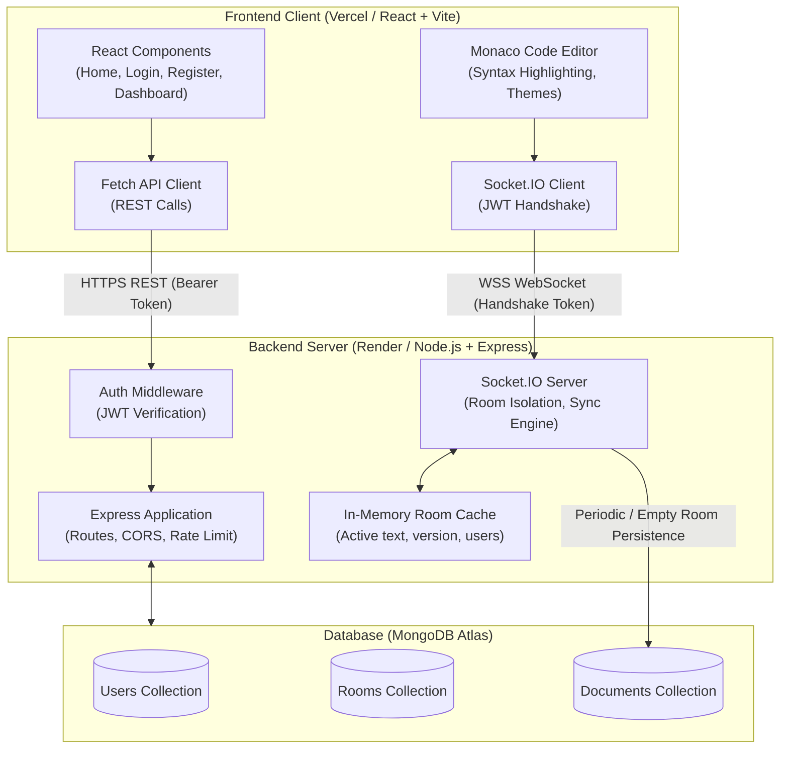
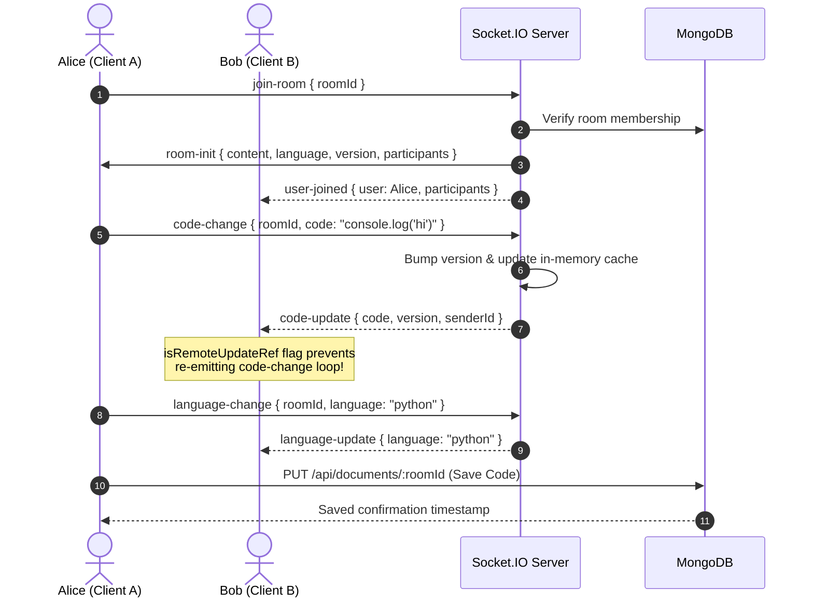

# Real-Time Collaborative Code Editor

A full-stack web application designed for university computer science courses, enabling multiple authenticated developers and students to join shared coding rooms, write and edit code simultaneously in real-time, synchronize syntax-highlighted code across languages, and persist their work securely in the cloud.

---

## 1. Abstract

Collaborative programming is a core competency in modern software engineering and educational environments. Traditional development environments often operate in silos, requiring manual code sharing via chat or version control branches for quick pair-programming tasks. The **Real-Time Collaborative Code Editor** resolves this by providing a lightweight, browser-accessible, synchronized development environment. Using React and Monaco Editor on the frontend with a Node.js, Express, Socket.IO, and MongoDB Atlas backend, this application enables real-time synchronized coding, robust role-based room access, and document persistence.

---

## 2. Problem Statement

Students and engineering teams frequently require immediate, concurrent code-sharing tools for:
1. Pair programming and laboratory assignments.
2. Technical interviews and code review sessions.
3. Interactive lectures and peer tutoring.

Existing commercial platforms (such as Google Docs) lack programming-specific features like syntax highlighting, language selection, and indentation rules. Conversely, full-featured cloud IDEs are resource-heavy, complex to set up, and incorporate unnecessary overhead (terminals, containers, build runners). There is a distinct need for a clean, reliable, focused real-time collaborative code editor that prioritizes simplicity, performance, and accessibility.

---

## 3. Objectives

- **Frontend Development:** Build an intuitive, responsive user interface using React, React Router, Vite, and plain CSS without heavy third-party UI framework bloat.
- **Code Editing Experience:** Integrate the industry-standard Monaco Editor supporting syntax highlighting, customizable font sizes, and line numbering across seven languages (JavaScript, Python, Java, C++, HTML, CSS, JSON).
- **Real-Time Synchronization:** Implement bidirectional, low-latency WebSocket communication via Socket.IO, ensuring instant synchronization between concurrent participants while avoiding infinite update feedback loops.
- **Security & Authentication:** Implement secure user registration and login with bcrypt password hashing, JSON Web Tokens (JWT), protected routes, and socket handshake authentication.
- **Cloud Persistence:** Securely save and retrieve document contents and language preferences using MongoDB and Mongoose.
- **Production Readiness:** Prepare the application for deployment with Vercel (frontend), Render (persistent backend web service), and MongoDB Atlas (cloud database).

---

## 4. Scope

### In-Scope
- User registration, login, JWT issuance, and authentication checks.
- Dashboard with room creation (generates human-readable unique Room IDs), room joining, leaving, and owner-only room deletion.
- Real-time code and language synchronization within isolated rooms.
- Active room participants count and live presence indicators.
- Document persistence (manual save button + debounced auto-save) to MongoDB.
- Language switcher supporting 7 popular languages.
- Health-check endpoint reporting server uptime and database connectivity.

### Out-of-Scope (Excluded by Design)
To maintain code clarity, reliability, and academic focus, the following are intentionally excluded:
- Third-party AI code generation or chatbots.
- Video and voice calling channels.
- Arbitrary code execution or remote container compiling.
- File tree/multi-file file explorers.
- Social feeds and gamification leaderboards.

---

## 5. Technology Stack

| Layer | Technology | Purpose |
|---|---|---|
| **Frontend Framework** | React.js (v18) + Vite | Fast, modern Single-Page Application (SPA) architecture |
| **Routing** | React Router DOM (v6) | Client-side routing with navigation guards |
| **Code Editor** | Monaco Editor (`@monaco-editor/react`) | Professional syntax highlighting, indentation, and dark theme |
| **Real-Time Transport** | Socket.IO Client (v4) | Bidirectional WebSocket communication with fallback |
| **Styling** | Plain CSS | Clean, custom, framework-free responsive styling |
| **Backend Runtime** | Node.js (v20+) | High-performance asynchronous JavaScript runtime |
| **Web Server** | Express.js (v4) | RESTful API routing, rate limiting, and middleware handling |
| **WebSockets** | Socket.IO Server (v4) | Room isolation, event dispatching, and socket authentication |
| **Database** | MongoDB / MongoDB Atlas | Scalable NoSQL document store |
| **ODM** | Mongoose (v8) | Schema validation, models, and population |
| **Authentication** | JSON Web Tokens (`jsonwebtoken`) & `bcryptjs` | Stateless session tokens and secure password hashing |
| **Deployment** | Vercel (Client) + Render (Server) | Decoupled cloud hosting for frontend and persistent sockets |

---

## 6. Architecture & System Design



---

## 7. Project Folder Structure

```
realtime-collaborative-code-editor/
├── .gitignore                      # Git ignore configuration
├── README.md                       # Comprehensive project documentation
├── client/                         # Frontend React application
│   ├── .env.example                # Example client environment variables
│   ├── index.html                  # HTML5 entry template
│   ├── package.json                # Client dependencies & scripts
│   ├── vercel.json                 # Vercel SPA route rewrite configuration
│   ├── vite.config.js              # Vite configuration
│   └── src/
│       ├── App.jsx                 # Main application routes & auth wrapper
│       ├── index.css               # Clean plain CSS stylesheet
│       ├── main.jsx                # React DOM entry point
│       ├── components/
│       │   ├── Navbar.jsx          # Top navigation bar
│       │   └── ProtectedRoute.jsx  # Route guard for authenticated users
│       ├── pages/
│       │   ├── Dashboard.jsx       # Room management & dashboard
│       │   ├── Editor.jsx          # Monaco editor & real-time sync UI
│       │   ├── Home.jsx            # Landing page
│       │   ├── Login.jsx           # User sign-in
│       │   └── Register.jsx        # User registration
│       └── services/
│           ├── api.js              # Fetch API HTTP client with auth headers
│           └── socket.js           # Socket.IO client singleton
└── server/                         # Backend Express & Socket.IO server
    ├── .env.example                # Example server environment variables
    ├── package.json                # Server dependencies & scripts
    ├── server.js                   # Main application entry point & HTTP setup
    ├── middleware/
    │   └── authMiddleware.js       # JWT validation middleware
    ├── models/
    │   ├── Document.js             # Code document schema (content, language)
    │   ├── Room.js                 # Room schema (owner, members, roomId)
    │   └── User.js                 # User schema (name, email, passwordHash)
    ├── routes/
    │   ├── authRoutes.js           # /api/auth (register, login, me)
    │   ├── documentRoutes.js       # /api/documents (get, update)
    │   └── roomRoutes.js           # /api/rooms (create, list, join, leave, delete)
    └── sockets/
        └── socketHandler.js        # Socket.IO event router & room sync logic
```

---

## 8. Database Schema

### User Schema (`models/User.js`)
| Field | Type | Attributes | Description |
|---|---|---|---|
| `name` | String | Required, Trim (2-50 chars) | Full name of the user |
| `email` | String | Required, Unique, Lowercase, Trim | Registered email address |
| `passwordHash` | String | Required | Salted bcrypt hash of user's password |
| `createdAt` | Date | Default: `Date.now` | Account creation timestamp |

### Room Schema (`models/Room.js`)
| Field | Type | Attributes | Description |
|---|---|---|---|
| `name` | String | Required, Trim | Name of the coding session |
| `roomId` | String | Required, Unique, Indexed | Unique code (e.g. `room-9b2f-4a1e`) |
| `owner` | ObjectId | Ref: `'User'`, Required | User ID of room creator |
| `members` | [ObjectId] | Ref: `'User'` | Array of authorized participant User IDs |
| `createdAt` | Date | Default: `Date.now` | Room creation date |
| `updatedAt` | Date | Default: `Date.now` | Last activity date |

### Document Schema (`models/Document.js`)
| Field | Type | Attributes | Description |
|---|---|---|---|
| `roomId` | String | Required, Unique, Indexed | Associated Room ID |
| `content` | String | Default boilerplate code | Code contents of the editor |
| `language` | String | Default: `'javascript'`, Enum | Language (`javascript`, `python`, etc.) |
| `updatedBy` | ObjectId | Ref: `'User'` | Last user who saved or changed code |
| `updatedAt` | Date | Default: `Date.now` | Timestamp of last database persist |

---

## 9. REST API Reference

All protected endpoints require the HTTP header:
`Authorization: Bearer <token>`

### Health Check
- **`GET /api/health`**
  - Public endpoint.
  - Returns: `{ status: "ok", uptime: 120.4, database: { connected: true, status: "Connected" } }`.

### Authentication Endpoints (`/api/auth`)
- **`POST /api/auth/register`**
  - Request body: `{ name, email, password, confirmPassword }`
  - Validates input, hashes password, saves user, returns JWT and user payload.
- **`POST /api/auth/login`**
  - Request body: `{ email, password }`
  - Validates credentials against bcrypt hash, returns JWT and user payload.
- **`GET /api/auth/me`** *(Protected)*
  - Validates bearer token, returns currently logged-in user profile without password hash.

### Room Endpoints (`/api/rooms`)
- **`POST /api/rooms`** *(Protected)*
  - Request body: `{ name, language }`
  - Creates a new room with a unique `roomId`, registers owner, initializes default document record.
- **`GET /api/rooms`** *(Protected)*
  - Returns an array of rooms where the user is either the owner or a joined member.
- **`GET /api/rooms/:roomId`** *(Protected)*
  - Validates room membership. Returns room details and populated member lists.
- **`POST /api/rooms/:roomId/join`** *(Protected)*
  - Adds the current authenticated user to the room's `members` array.
- **`POST /api/rooms/:roomId/leave`** *(Protected)*
  - Removes a member from the room's `members` array (owners cannot leave; they must delete).
- **`DELETE /api/rooms/:roomId`** *(Protected)*
  - Verifies ownership; deletes the room and its associated document.

### Document Endpoints (`/api/documents`)
- **`GET /api/documents/:roomId`** *(Protected)*
  - Retrieves the latest saved code content and programming language for an authorized room.
- **`PUT /api/documents/:roomId`** *(Protected)*
  - Request body: `{ content, language }`
  - Persists code content and language to MongoDB, recording `updatedBy` and `updatedAt`.

---

## 10. Real-Time Synchronization Protocol

### Socket.IO Handshake Authentication
1. When connecting, the client transmits its JWT in the socket handshake auth payload:
   ```javascript
   io(SOCKET_URL, { auth: { token: localStorage.getItem('token') } });
   ```
2. The server middleware (`io.use`) decodes the JWT using `process.env.JWT_SECRET`, resolves the user from the database, and binds `socket.user = { id, name, email }`. Unauthenticated sockets are rejected immediately.

### Room Isolation & Event Lifecycle


### Prevention of Infinite Update Loops
When Client A edits code, Monaco Editor fires `onChange`. Client A emits `code-change`.
When Client B receives `code-update`, updating Monaco's state directly would naturally trigger Client B's `onChange`, which without protection would emit another `code-change` back to Client A, creating a devastating ping-pong feedback loop.

**Solution:**
In `Editor.jsx`, an `isRemoteUpdateRef` flag is set to `true` immediately before setting state with incoming remote content. The editor's `handleCodeChange` inspects this flag:
```javascript
if (isRemoteUpdateRef.current) {
  return; // Suppress outgoing emission for incoming socket updates
}
```
A 50ms buffer ensures that asynchronous DOM updates finish before the flag reverts, ensuring zero infinite loops.

---

## 11. Local Development Setup

### Prerequisites
- **Node.js**: v18.0.0 or higher
- **npm**: v9.0.0 or higher
- **MongoDB**: Local MongoDB instance running on `localhost:27017` OR a free MongoDB Atlas cloud cluster URI.

### 1. Clone or Open the Repository
```bash
git clone <repository-url>
cd realtime-collaborative-code-editor
```

### 2. Configure Backend Environment
Navigate to `server/`:
```bash
cd server
copy .env.example .env
```
Ensure your `.env` contains:
```env
PORT=5000
MONGODB_URI=mongodb://127.0.0.1:27017/collaborative-editor
JWT_SECRET=my_local_development_secret_key_2026
CLIENT_URL=http://localhost:5173
NODE_ENV=development
```
Install dependencies and run the server:
```bash
npm install
npm run dev
```
The server will start on `http://localhost:5000`. You can test health by visiting `http://localhost:5000/api/health`.

### 3. Configure Frontend Environment
In a new terminal, navigate to `client/`:
```bash
cd client
copy .env.example .env
```
Ensure `.env` contains:
```env
VITE_API_URL=http://localhost:5000/api
VITE_SOCKET_URL=http://localhost:5000
```
Install dependencies and start the Vite dev server:
```bash
npm install
npm run dev
```
Open your browser at `http://localhost:5173`.

---

## 12. Deployment Guide

The production architecture separates the static frontend (Vercel) from the stateful WebSocket backend (Render) and managed database (MongoDB Atlas).

### Step 1: MongoDB Atlas Setup
1. Log in to [MongoDB Atlas](https://www.mongodb.com/atlas).
2. Create a free shared cluster (e.g. `M0 Sandbox`).
3. Under **Database Access**, create a database user (e.g., `app-user`) with read and write permissions.
4. Under **Network Access**, add IP address `0.0.0.0/0` (Allow access from anywhere) so Render can connect dynamically.
5. Click **Connect** -> **Drivers** (Node.js) and copy the connection string:
   `mongodb+srv://<username>:<password>@cluster0.example.mongodb.net/collaborative-editor?retryWrites=true&w=majority`

### Step 2: Push Project to GitHub
1. Initialize git and commit:
   ```bash
   git init
   git add .
   git commit -m "Initial commit: Real-Time Collaborative Code Editor"
   ```
2. Create a new repository on GitHub and push:
   ```bash
   git remote add origin https://github.com/<your-username>/realtime-collaborative-code-editor.git
   git branch -M main
   git push -u origin main
   ```

### Step 3: Deploy Persistent Backend on Render
1. Log in to [Render](https://render.com).
2. Click **New +** -> **Web Service**.
3. Connect your GitHub repository.
4. Configure the service:
   - **Name:** `collaborative-editor-api`
   - **Root Directory:** `server`
   - **Environment:** `Node`
   - **Build Command:** `npm install`
   - **Start Command:** `npm start`
   - **Plan:** Free
5. In **Environment Variables**, add:
   - `MONGODB_URI`: `<Your MongoDB Atlas connection string>`
   - `JWT_SECRET`: `<A long random string>`
   - `CLIENT_URL`: `https://your-frontend-app.vercel.app` (or `*` temporarily until Vercel URL is known)
   - `NODE_ENV`: `production`
6. Click **Deploy Web Service**.
7. Once deployed, copy your Render service URL (e.g., `https://collaborative-editor-api.onrender.com`).
8. Verify health at `https://collaborative-editor-api.onrender.com/api/health`.

### Step 4: Deploy Frontend on Vercel
1. Log in to [Vercel](https://vercel.com).
2. Click **Add New...** -> **Project**.
3. Import your GitHub repository.
4. Configure the project:
   - **Framework Preset:** Vite
   - **Root Directory:** `client`
5. In **Environment Variables**, add:
   - `VITE_API_URL`: `https://collaborative-editor-api.onrender.com/api`
   - `VITE_SOCKET_URL`: `https://collaborative-editor-api.onrender.com`
6. Click **Deploy**.
7. Once finished, Vercel provides your live domain (e.g., `https://collaborative-editor.vercel.app`).
8. Return to Render and update `CLIENT_URL` to your exact Vercel domain to enforce strict CORS security.

---

## 13. University Faculty Demonstration Plan

Follow this exact 5-minute walkthrough during your project demonstration:

1. **System Introduction & Landing Page (1 min):**
   - Open the web application. Show the clean layout, project title, and description.
   - Explain the architecture: React + Vite on Vercel, Node + Express + Socket.IO on Render, MongoDB Atlas.
2. **Authentication Demonstration (1 min):**
   - Click **Register**. Create account `alice@univ.edu`. Explain how passwords are salted and hashed with bcrypt on the server, and a JWT is issued.
   - Show automatic redirect to the protected `/dashboard`.
3. **Room Creation & Isolation (1 min):**
   - In Dashboard, create a room named `"Algorithm Review"`.
   - Show the generated unique Room ID (e.g. `room-4f8a-9b1c`).
   - Click into the room to enter Monaco Editor.
4. **Live Real-Time Concurrent Editing (1.5 min):**
   - Open an Incognito window or second browser (Chrome vs. Edge / Firefox).
   - Log in as a second user (`bob@univ.edu`).
   - From the dashboard, paste Alice's Room ID into "Join Existing Room" and click **Join Room**.
   - Place both browser windows side by side.
   - Type code in Alice's window: watch Bob's editor update simultaneously in real-time.
   - Change programming language from JavaScript to Python in Bob's editor: watch Alice's editor syntax highlight dynamically.
   - Point out the active participants panel showing both `Alice` and `Bob (You)`.
5. **Persistence & Refresh Test (30 sec):**
   - Click **Save Code** (or let debounced auto-save trigger). Note the "Saved at HH:MM:SS" status.
   - Refresh both browser windows.
   - Show faculty that all edited code and language selections were retrieved seamlessly from MongoDB.

---

## 14. Testing & Verification Checklist

| Test Case | Expected Behavior | Status |
|---|---|---|
| User Registration | Valid data registers user; returns JWT token | Passed |
| Duplicate Email Check | Rejects duplicate email registration with 409 conflict | Passed |
| User Login | Valid credentials authenticate; invalid return 401 | Passed |
| Protected Routes | Unauthenticated requests redirected to `/login` | Passed |
| Room Creation | Unique room ID generated; creator assigned as owner | Passed |
| Room Membership Access | Non-members blocked from viewing/editing room documents | Passed |
| Room Join | Existing room can be joined via Room ID | Passed |
| Real-Time Code Sync | Live edits broadcast to peers via WebSockets | Passed |
| Infinite Loop Prevention | `isRemoteUpdateRef` stops recursive event bouncing | Passed |
| Language Sync | Changing language updates syntax mode across peers | Passed |
| Active Presence | Participants list shows currently connected users | Passed |
| Document Persistence | Code and language save and restore from MongoDB | Passed |
| Owner Deletion | Room owner can delete room; non-owners blocked | Passed |
| Clean SPA Routing | Vercel rewrites allow direct refresh on `/dashboard` and `/editor/:id` | Passed |

---

## 15. Known Limitations & Future Enhancements

### Known Limitations
- **Serverless Backend Restriction:** Persistent Socket.IO WebSockets require a stateful Node.js container (like Render or Railway) and cannot run inside standard serverless functions (like AWS Lambda or Vercel serverless functions).
- **Free Tier Cold Starts:** Free instances on Render spin down after periods of inactivity, causing a ~30-50 second delay on initial wake-up.
- **Concurrent Typing Collisions:** Current implementation uses an efficient server-authoritative broadcast model. For enterprise simultaneous typing in the exact same line, CRDT algorithms (e.g., Yjs) provide fine-grained character-level operational transformation.

### Future Enhancements
- CRDT/Yjs integration for character-by-character conflict-free cursor position tracking.
- Read-only shared links for grading and non-interactive presentation mode.
- Export code directly as downloadable source files (`.py`, `.js`, `.cpp`).
